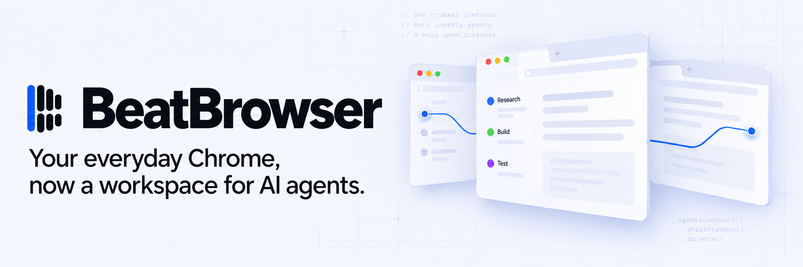
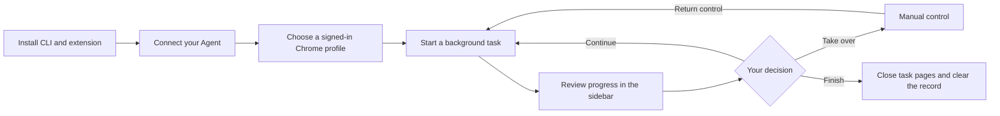
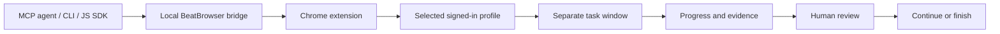

# BeatBrowser

[English](README.md) · [简体中文](README.zh-CN.md)

**Your everyday Chrome, now a workspace for AI agents.**

An open-source browser toolkit by [BeatAPI](https://beatapi.io). Connect MCP-capable agents to the Chrome profile you already use, with its existing website sessions. Give background tasks their own windows, follow their progress and take over when needed.

[Quick start](#quick-start) · [Background workspace](#background-workspace) · [Tools](#tools) · [JavaScript SDK](docs/JAVASCRIPT.md) · [Privacy](PRIVACY.md) · [MIT](LICENSE)

> **Version 1.3.2** keeps tasks in the extension workspace without creating Chrome tab groups. [Install](docs/INSTALL.md) · [Release notes](docs/RELEASE_NOTES.md)

## One browser toolkit across your agents

Use BeatBrowser from Claude Code, Codex CLI, Cursor or another client that can launch a local stdio MCP server. Your agent provides the reasoning; BeatBrowser provides the browser tools.

> “Open a background task on example.com, read the title and report the result. Pause for my review, then finish after I return control.”

- **Keep your website sessions.** Work in a selected, already signed-in Chrome profile without exporting cookies or migrating browser data.
- **Work in a separate task window.** Keep task pages and progress in a Chinese/English sidebar. View, pause, resume or stop from one place.
- **Recover after updates.** Task records and progress survive extension reloads. Unfinished tasks restore paused; completed tasks stay completed. Missing pages can be explicitly reassociated.
- **Clean up when done.** Clear one ended task, clear ended tasks in a batch, or confirm clearing everything. User-associated, handed-over and moved pages are protected.

Normal browser control needs no BeatBrowser account or API key. Your agent needs its own model access. BeatBrowser is also included in [BeatGEO](https://github.com/BeatAPI/BeatGEO), which adds brand monitoring, evidence and retests.

## Quick start

Prepare **Node.js 20+, Chrome 116+**, and a compatible local MCP client.

```sh
npm install --global @beatapi/beat-browser@1.3.2
beat-browser install --dry-run
beat-browser install
beat-browser extension
```

1. Keep the global installation in place. In the Chrome profile you want to use, open `chrome://extensions` and enable **Developer mode**.
2. Choose **Load unpacked** and select the extension folder printed by the command. Load only one copy per profile.
3. Restart your Agent client. Run `beat-browser doctor --json`; readiness requires `ok: true` and `extensionOnline: true`.
4. Ask the agent to list connected profiles, choose the intended one and start a small read-only task. Open the extension → **Workspace** to follow it.

The installer previews client configuration changes with `--dry-run` and backs up changed configurations when applied. An installed configuration adapter is not an end-to-end certification of every Agent client. [Agent installation](AGENT_INSTALL.md)

**Using BeatGEO?** Follow its setup instead. It installs a fixed BeatBrowser revision and prepares the extension; you do not need another clone or global CLI.

[Download the matching CLI and extension, or install from source](docs/INSTALL.md). The extension ZIP alone is not the full installation. The Chrome extension is loaded unpacked and is not listed in the Chrome Web Store.

## From installation to a finished task



BeatBrowser supplies browser tools; the Agent decides the steps. You can inspect the workspace, take over a task, and clean up completed tasks without clearing your everyday tabs. In BeatGEO, setup prepares the included extension, and the monitoring worker calls this same browser layer.

## Background workspace



TaskSpaces use a separate window in your existing profile; they are not separate cookie containers. A site popup or native browser behavior can still gain focus. Focusing a running task pauses subsequent automation; this cannot undo an action already in flight. Background work is the intended experience, not a guarantee of invisible operation.

After a reload, inspect recovered pages before continuing. Live pages are recovered by their native Chrome target identity. After a full browser restart, use **Reconnect pages** to confirm page associations; matching URLs alone never transfer control. Tasks lost before recovery was introduced cannot be reconstructed. Agent reconnection restores routing; an explicitly authorized new session can claim a recovered task without resuming it automatically.

When updating, finish active work first, update the matching source, reload the extension and restart the local bridge and Agent connections. Do not delete local storage to update. [Task lifecycle and recovery](docs/TASKSPACES.md)

## Tools

BeatBrowser exposes **24 normal MCP tools**, including `spaces` for background tasks.

| Purpose | Tools |
| --- | --- |
| Observe | `snapshot`, `read_text`, `query`, `screenshot` |
| Navigate | `navigate`, `tabs` |
| Act | `act`, `click`, `type`, `fill`, `select`, `key`, `scroll`, `wait` |
| Transfer data | `network`, `fetch`, `download`, `upload` |
| Work with people and context | `ask`, `status`, `learnings`, `spaces` |
| Advanced | `eval`, `reload` |

Snapshot before acting, pass explicit `tabId`/`spaceId`, and check the result. A successful click receipt is not proof of the business outcome. Use `ask` for login, CAPTCHA, OTP or a decision requiring the user. Multiple clients can connect; ordinary writes to the same tab are not isolated.

Reviewed site notes and playbooks can be shared locally through `~/.beat-browser/learnings/`. This is reusable context, not automatic model training. [JavaScript SDK](docs/JAVASCRIPT.md) · [Demo guide](docs/DEMO.md) · [Dated integration comparison](docs/COMPARISON.md)

## Optional BeatAPI execution

The optional **Fast JEV** executor lets a BeatAPI model choose from a bounded set of browser actions. It uses the same connection and is **off by default**. Live use requires a BeatAPI key and explicit task consent. Normal mode does not require it.

```sh
beat-browser run --dry-run \
  --url https://example.com \
  --goal 'Check that the Example Domain page is ready'
```

Dry-run makes no model call and opens no browser connection. Fast JEV currently targets top-frame light DOM, not iframes or shadow DOM; it stops on uncertainty instead of replaying an uncertain submission. [Configuration and consent](docs/JEV_FAST_AGENT.md)

## Privacy and boundaries

The local bridge listens on `127.0.0.1`; Agent connections require a local token. Normal mode adds no BeatBrowser cloud service or telemetry, but tool output still reaches your chosen Agent and its provider. Task labels, progress and lifecycle metadata persist locally until cleared; URL fingerprints support page recovery.

The extension has broad browser permissions and trusts the local machine. It does not protect against malicious local software or extensions. Task focus gates and `act` checks are not universal authorization controls: individual tools or JavaScript can write to websites. Use trusted agents and retain action-specific approval for consequential operations. [Full privacy details](PRIVACY.md)

## Development and verification

```sh
npm ci
npm test
npm run check:syntax
npm run check:security
npm run check:package
npm run build:extension
```

Task recovery passed isolated real Chromium extension-reload and browser-restart checks. These do not establish macOS foreground-focus behavior or every Agent client's compatibility. See [workspace acceptance](docs/PREVIEW_TESTING.md), [TaskSpace checks](docs/TASKSPACES.md), [historical results](TEST_RESULTS.md) and [release procedure](docs/RELEASING.md).

## Credits and license

[MIT](LICENSE). Based on [huashu-chrome](https://github.com/alchaincyf/huashu-chrome) by [alchaincyf](https://github.com/alchaincyf), with the original copyright preserved. BeatAPI maintains the distribution and adds TaskSpaces, recovery, the workspace UI and optional Fast JEV execution.
