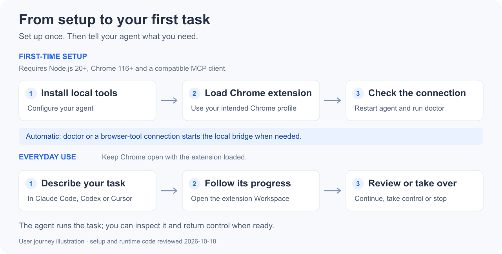
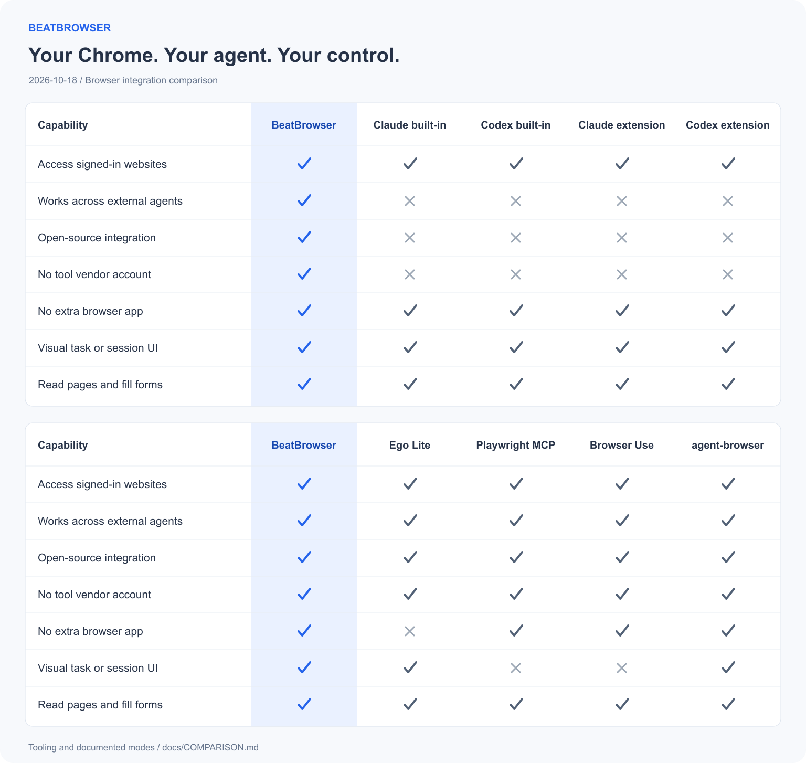
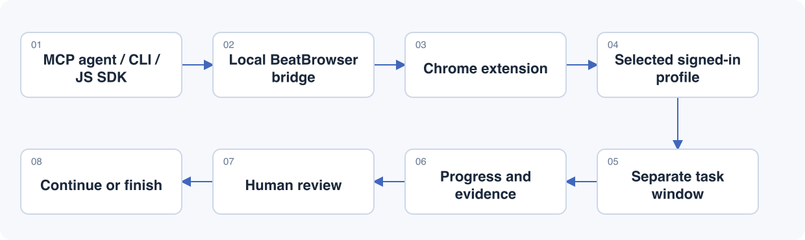

[](https://beatapi.io/browser)

<p align="center">
    <a href="https://linux.do" alt="LINUX DO"></a>
</p>

# BeatBrowser

**[English](README.md)** · [简体中文](README.zh-CN.md)

**Your Chrome. Now an agent browser.**

**No browser switch. No login migration. Your choice of agent.**

Connect Codex, Claude Code and other compatible agents directly to the Chrome you already use. Keep your website logins, run tasks in background windows, and take over when needed. BeatBrowser is a free, MIT-licensed Chrome extension and local bridge.

[Get started](#quick-start) · [Cloud agents](#cloud-agents-your-chrome) · [Examples](#what-you-can-do) · [Compare](#compare-browser-integrations) · [JavaScript SDK](docs/JAVASCRIPT.md) · [Website](https://beatapi.io/browser)

Normal local browser tools are **free**, with **no BeatBrowser account or API key**. Your agent uses its own model access.

## Why BeatBrowser

| Why choose BeatBrowser | What you get |
| --- | --- |
| **Keep Chrome** | Use your existing browser and profile. |
| **Keep your logins** | No cookie export or profile migration. |
| **Choose your agent** | Codex, Claude Code, WorkBuddy and more. |
| **Own the toolchain** | Extension, bridge, MCP, CLI and SDK source. |
| **Work in the background** | Task windows with pause and takeover. |
| **Cloud access preview** | Self-hosted access to your local Chrome. |

The extension, local bridge, MCP server, CLI and Node SDK are public under [MIT](LICENSE). Task windows share their Chrome profile's cookies and storage.

## Choose your mode

| Mode | Agent location | Setup |
| --- | --- | --- |
| **Local Agent** | Your computer | Tools + extension; no domain or tunnel. |
| **Cloud Agent** | Remote / cloud | Tools + extension + credential + your own tunnel. |

Local mode is the default; installation does not enable remote access. Both modes
use your computer's Chrome. Version `1.4.1` includes the optional cloud adapter as a preview. [Cloud Agent setup](docs/REMOTE.md)

### Bring the agent you use

| Mode | Agent examples |
| --- | --- |
| Local | Codex, Claude Code, WorkBuddy, OpenCode, Kimi Code |
| Cloud | Muse, Grok Bot, OpenClaw, Hermes |

OpenClaw and Hermes are shown here as cloud deployment examples; they also work
in Local Agent mode when their tools run on your computer.
More agents, configuration details and verification status are listed in the
[Agent directory](docs/AGENT_DIRECTORY.md).

## Quick start

For **Local Agent mode**: **Node.js 20+**, **Chrome 116+**, and a client that can launch a local stdio MCP server. Setup has two parts: the local tools and the Chrome extension.



### 1. Install the local tools

```sh
npm install --global @beatapi/beat-browser@1.4.1
beat-browser install --dry-run
beat-browser install
beat-browser extension
```

`--dry-run` previews detected client configuration changes. The installer backs up changed configurations; keep the installation so the extension folder stays at a stable path.

### 2. Load the Chrome extension

1. In the Chrome profile you want to use, open `chrome://extensions` and enable **Developer mode**.
2. Choose **Load unpacked** and select the folder printed by `beat-browser extension`. Load one copy per profile.
3. Restart your agent client and check the connection:

```sh
beat-browser doctor --json
```

Ready means `ok: true` and `extensionOnline: true`. The extension is currently loaded unpacked, rather than installed from the Chrome Web Store.

[Matching downloads and source setup](docs/INSTALL.md) · [Agent installation guide](AGENT_INSTALL.md) · [Release notes](docs/RELEASE_NOTES.md)

<details>
<summary>Let your agent guide setup</summary>

Paste this into your agent:

```text
Set up BeatBrowser from https://github.com/BeatAPI/BeatBrowser.
Read AGENT_INSTALL.md, preview configuration changes, then guide me through
loading the Chrome extension. Verify doctor reports ok and extensionOnline.
```

Client configuration adapters are not a claim of end-to-end certification in every client. If you use [BeatGEO](https://github.com/BeatAPI/BeatGEO), follow its included BeatBrowser setup instead of installing a second copy.

</details>

### Try your first task

```text
Use BeatBrowser. List connected Chrome profiles and ask me to choose if there
is more than one. Open a background task on https://example.com, read the
page title, report the result, and pause for my review.
```

Open the extension → **Workspace** to inspect the task. The agent supplies the reasoning; BeatBrowser supplies the browser tools.

## Cloud agents, your Chrome

**Run the agent in the cloud. Keep the browser on your computer.**

The optional remote adapter lets compatible cloud agents operate your signed-in
Chrome through your own authenticated Cloudflare Tunnel. Use your own hostname,
give each agent a separate credential, and inspect tasks in the extension Workspace.
No cloud browser rental or BeatBrowser account is required; your computer must stay online.

**Opt-in preview:** version `1.4.1` includes remote commands in both the source and npm package. [Configure cloud access](docs/REMOTE.md) for Muse, Grok Bot or another
client supporting Bearer-authenticated HTTP MCP, HTTP calls or WebSocket.
Client-specific settings and signed-in tasks require end-to-end verification.

## What you can do

| Task | Example prompt |
| --- | --- |
| Read signed-in pages | “Extract the requested fields from these pages into a table with source URLs. Do not modify records.” |
| Prepare a form | “Fill this form with the supplied information, check the values, then pause before the final submit.” |
| Compare sources | “Read these two URLs in separate background tasks, summarize each source and wait for review.” |

These are example prompts; no demo video is available yet. Some sites save while you type; use a dedicated demo form when rehearsing. [Example task walkthrough](docs/DEMO.md)

## Compare browser integrations

The chart compares browser integrations and documented modes, not model quality or benchmark performance.



<!-- comparison-tables:start -->
<details>
<summary>View the checkmark tables as text</summary>

| Capability | BeatBrowser | Claude built-in | Codex built-in | Claude extension | Codex extension |
| --- | :---: | :---: | :---: | :---: | :---: |
| Access signed-in websites | ✅ | ✅ | ✅ | ✅ | ✅ |
| Works across external agents | ✅ | ❎ | ❎ | ❎ | ❎ |
| Open-source integration | ✅ | ❎ | ❎ | ❎ | ❎ |
| No tool vendor account | ✅ | ❎ | ❎ | ❎ | ❎ |
| No extra browser app | ✅ | ✅ | ✅ | ✅ | ✅ |
| Visual task or session UI | ✅ | ✅ | ✅ | ✅ | ✅ |
| Read pages and fill forms | ✅ | ✅ | ✅ | ✅ | ✅ |

| Capability | BeatBrowser | Ego Lite | Playwright MCP | Browser Use | agent-browser |
| --- | :---: | :---: | :---: | :---: | :---: |
| Access signed-in websites | ✅ | ✅ | ✅ | ✅ | ✅ |
| Works across external agents | ✅ | ✅ | ✅ | ✅ | ✅ |
| Open-source integration | ✅ | ✅ | ✅ | ✅ | ✅ |
| No tool vendor account | ✅ | ✅ | ✅ | ✅ | ✅ |
| No extra browser app | ✅ | ❎ | ✅ | ✅ | ✅ |
| Visual task or session UI | ✅ | ✅ | ❎ | ❎ | ✅ |
| Read pages and fill forms | ✅ | ✅ | ✅ | ✅ | ✅ |

</details>
<!-- comparison-tables:end -->

Open source means integration tooling, not the host app or browser engine. Ego can import Chrome logins; BeatBrowser connects to the existing Chrome profile through its extension and local bridge. Playwright includes extension mode, Browser Use means the local library/CLI, and agent-browser includes its Dashboard. Reviewed 2026-10-18. [Definitions and primary sources](docs/COMPARISON.md).

**Detailed comparisons:** [Ego Lite](docs/comparisons/ego-lite.md) · [Claude built-in](docs/comparisons/claude-built-in.md) · [Codex built-in](docs/comparisons/codex-built-in.md) · [Claude extension](docs/comparisons/claude-extension.md) · [Codex extension](docs/comparisons/codex-extension.md) · [Playwright MCP](docs/comparisons/playwright-mcp.md) · [Browser Use](docs/comparisons/browser-use.md) · [agent-browser](docs/comparisons/agent-browser.md).

## Background workspace



*Workflow illustration. Inspect actual tasks in the extension popup or sidebar.*

Tasks keep named pages, progress and a lifecycle history. You can take over a page, explicitly return control, or stop the task. Completed tasks can be cleared individually or in a batch while protecting user-associated, handed-over and moved pages.

<details>
<summary>Recovery and current limits</summary>

- Extension reloads restore task records, labels and progress; unfinished tasks restore **paused**. After a full browser restart, use **Reconnect pages** to confirm missing page associations before continuing. Matching URLs alone never grant control.
- There are at most **four nonterminal tasks per owner** and **sixteen pages per task**. These are task windows, not isolated cookie containers.
- Focusing a running task pauses subsequent automation, but does not undo an action already in flight. Site popups or native browser UI can still gain focus.
- **Minimized headed screenshots remain a known gap.** Background execution does not guarantee invisible operation or support for every native permission dialog.
- Finish active work before updating. Keep CLI and extension versions aligned, reload the extension and reconnect agents. Retain extension storage to preserve records.

[Task lifecycle, recovery and verification](docs/TASKSPACES.md) · [Workspace acceptance](docs/PREVIEW_TESTING.md)

</details>

## Tools

Local Agent mode exposes **24 normal MCP tools**, including `spaces` for background tasks.
Cloud Agent mode exposes 21, excluding local file tools and saved learnings; see [remote scope](docs/REMOTE.md#scope-and-validation).

| Purpose | Tools |
| --- | --- |
| Observe | `snapshot`, `read_text`, `query`, `screenshot` |
| Navigate | `navigate`, `tabs` |
| Act | `act`, `click`, `type`, `fill`, `select`, `key`, `scroll`, `wait` |
| Transfer data | `network`, `fetch`, `download`, `upload` |
| Work with people and context | `ask`, `status`, `learnings`, `spaces` |
| Advanced | `eval`, `reload` |

Snapshot before acting, pass explicit `tabId`/`spaceId`, and check the result. A successful click receipt is not proof of the business outcome. Use `ask` for login, CAPTCHA, OTP or a decision requiring the user. Multiple clients can connect; ordinary writes to the same tab are not isolated.

Reviewed site notes and playbooks can be shared locally through `~/.beat-browser/learnings/`. This is reusable context, not automatic model training. [JavaScript SDK](docs/JAVASCRIPT.md) · [Example task walkthrough](docs/DEMO.md) · [Dated integration comparison](docs/COMPARISON.md)

## Privacy

Normal mode uses a local bridge on `127.0.0.1` with token-authenticated agent connections. It adds no BeatBrowser cloud service or telemetry. Tool output still reaches your chosen agent and model provider; local task records remain until cleared.

The extension has broad browser permissions. Use trusted agents and explicit approval for consequential actions: task controls are not a universal authorization system. [Full privacy and permission details](PRIVACY.md)

## Development and reference

```sh
npm ci
npm test
npm run check:syntax
npm run check:security
npm run check:comparison
npm run check:package
```

[JavaScript SDK](docs/JAVASCRIPT.md) · [Agent setup](AGENT_INSTALL.md) · [Architecture](media/architecture.svg) · [Test results](TEST_RESULTS.md) · [Release procedure](docs/RELEASING.md) · [Report an issue](https://github.com/BeatAPI/BeatBrowser/issues)

Bug reports and pull requests are welcome. Include the CLI/extension versions, reproduction steps and sanitized output. Do not include tokens, cookies or private page data. Unit and isolated Chromium checks do not certify every agent client or macOS foreground-focus behavior.

<details>
<summary>Optional BeatAPI execution — Fast JEV</summary>

The optional Fast JEV executor lets a BeatAPI model choose from a bounded set of browser actions. It uses the same connection, is **off by default**, and requires a BeatAPI key and explicit task consent. Normal browser tools do not require it.

```sh
beat-browser run --dry-run \
  --url https://example.com \
  --goal 'Check that the Example Domain page is ready'
```

Dry-run makes no model call and opens no browser connection. Fast JEV targets top-frame light DOM, not iframes or shadow DOM; it stops on uncertainty instead of replaying an uncertain submission. [Configuration and consent](docs/JEV_FAST_AGENT.md)

</details>

## License

Released under the [MIT License](LICENSE).
