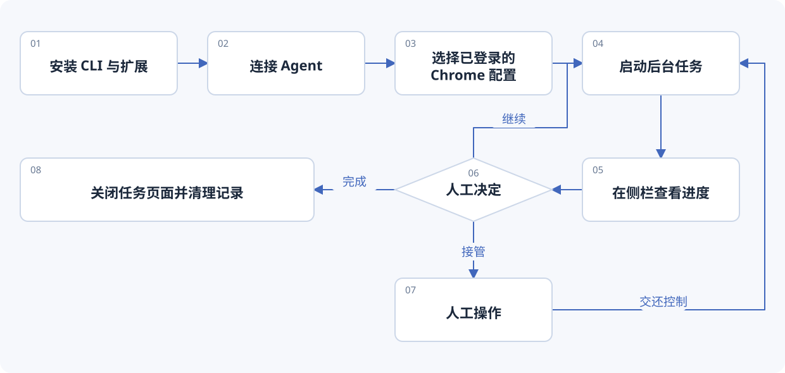
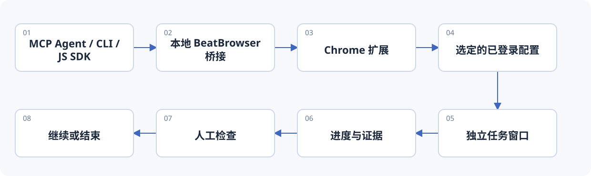

[](https://beatapi.io/browser)

# BeatBrowser

[English](README.md) · [简体中文](README.zh-CN.md)

**你的 Chrome，你的 Agent，由你掌控。**

[BeatAPI](https://beatapi.io) 出品的开源浏览器工具，让支持 MCP 的 Agent 使用你已经登录的 Chrome。后台任务使用独立窗口，你可以查看进度、接管操作，或随时停止。

[项目官网](https://beatapi.io/browser) · [对比](#浏览器接入方式对比) · [快速开始](#快速开始) · [后台工作区](#后台工作区) · [工具](#工具) · [JavaScript SDK](docs/JAVASCRIPT.md) · [隐私](PRIVACY.md) · [MIT](LICENSE)

> **1.3.2 版本**在插件工作区管理任务，不再自动创建 Chrome 标签组。[安装指南](docs/INSTALL.md) · [更新说明](docs/RELEASE_NOTES.md)

## 一套浏览器能力，供多个 Agent 使用

可用于 Claude Code、Codex CLI、Cursor，以及能够启动本地 stdio MCP 服务的其他客户端。Agent 负责推理，BeatBrowser 提供浏览器工具。

> “在 example.com 创建后台任务，读取标题并报告结果。暂停等我检查，我交回控制后再结束。”

- **复用已有登录态。** 使用指定 Chrome 配置，无须导出 Cookie 或迁移浏览器数据。
- **任务有自己的窗口。** 中英文侧栏集中显示任务、页面和进度，支持查看、暂停、继续与停止。
- **更新后找回任务。** 重载扩展保留任务和进度；未完成任务以暂停状态恢复，已完成任务保持完成。缺失页面可明确重新关联。
- **做完方便清理。** 单个清理、批量清理已结束任务，或确认后全部清理。保护用户关联、已交给用户和移出任务窗口的页面。

普通浏览器控制不需要 BeatBrowser 账号或 API Key；Agent 使用自己的模型服务。[BeatGEO](https://github.com/BeatAPI/BeatGEO) 已集成 BeatBrowser，并在其上提供品牌监测、证据和复测。

## 浏览器接入方式对比

| 接入方式 | 浏览器与登录态 | 任务工作区 | 原生接入范围 |
| --- | --- | --- | --- |
| Codex 内置浏览器（桌面版） | 独立配置，在 App 内登录 | App 内浏览器面板 | OpenAI 桌面整合 |
| Codex 官方浏览器插件 | 沿用现有浏览器配置与登录态 | 现有标签页，支持后台与多标签并行 | OpenAI 桌面整合 |
| Claude Code 内置浏览器（桌面版） | 独立配置，可登录并选择保留 Cookie | App 内 Browser 面板 | Claude Code 桌面版 |
| Claude Code + Claude in Chrome | 沿用现有浏览器配置与登录态 | 与会话关联的标签组 | 受支持的 Claude 原生入口 |
| **BeatBrowser** | **沿用已连接的 Chrome 配置与登录态** | **独立任务窗口，查看进度、暂停、接管** | **本地 MCP 客户端、CLI 与 JavaScript SDK** |

比较的是浏览器整合，不是模型能力。官方插件也支持后台与多标签工作。BeatBrowser 为兼容 Agent 提供同一套 MIT 开源浏览器工具；独立任务窗口仍共享同一配置的网站登录态。[详细比较与官方来源](docs/COMPARISON.md)。

## 快速开始

需要 **Node.js 20+、Chrome 116+** 和兼容的本地 MCP 客户端。

```sh
npm install --global @beatapi/beat-browser@1.3.2
beat-browser install --dry-run
beat-browser install
beat-browser extension
```

1. 保留全局安装目录。在要使用的 Chrome 配置中打开 `chrome://extensions`，启用**开发者模式**。
2. 点击**加载已解压的扩展程序**，选择命令输出的扩展目录。每个配置只加载一份。
3. 重启 Agent 客户端。运行 `beat-browser doctor --json`，就绪状态应为 `ok: true`、`extensionOnline: true`。
4. 让 Agent 列出已连接配置，选中目标配置，先做一个小型只读任务。点击扩展 → **工作区**查看进度。

`--dry-run` 预览客户端配置改动，实际安装会备份被修改的配置。支持某个客户端的安装配置，不代表已经对每个客户端完成端到端验收。[Agent 安装指南](AGENT_INSTALL.md)

**使用 BeatGEO 的用户：** 直接按 BeatGEO 的安装流程操作。它会安装固定版本并准备扩展，不需要第二次克隆或安装全局 CLI。

见[配套 CLI、扩展下载与源码安装](docs/INSTALL.md)。扩展 ZIP 只是其中一部分。当前通过加载已解压扩展安装，尚未上架 Chrome 应用商店。

## 从安装到完成任务



BeatBrowser 提供浏览器工具，由 Agent 决定具体步骤。你可以查看工作区、接管任务、清理已完成任务，而不清理日常浏览标签页。在 BeatGEO 中，安装流程准备内置扩展，监测工作进程调用同一套浏览器能力。

## 后台工作区



任务窗口复用同一配置的登录态，并不是独立 Cookie 容器。网站弹窗或浏览器原生行为仍可能获得焦点。任务窗口被聚焦时会暂停后续自动化，但无法撤回已经发出的操作。后台执行是目标体验，不等于绝对隐形或永不抢焦点。

重载后先确认恢复的页面，再继续任务。扩展重载后按 Chrome 原生页面标识恢复关联；浏览器彻底重启后，通过**关联页面**确认归属，再继续任务。不会仅凭相同网址接管页面。此前已丢失的旧记录无法补回。原 Agent 重连后可恢复路由；新 Agent 经明确授权可以接手恢复的任务，但不会因此自动继续执行。

更新前先结束正在执行的操作，更新配套源码，重载扩展，再重启本地桥接服务和 Agent 连接。更新不需要删除本地存储。[任务生命周期与恢复](docs/TASKSPACES.md)

## 工具

包含 **24 个普通 MCP 工具**，其中 `spaces` 用于后台任务。

| 用途 | 工具 |
| --- | --- |
| 观察 | `snapshot`、`read_text`、`query`、`screenshot` |
| 导航 | `navigate`、`tabs` |
| 操作 | `act`、`click`、`type`、`fill`、`select`、`key`、`scroll`、`wait` |
| 数据传输 | `network`、`fetch`、`download`、`upload` |
| 人工与上下文 | `ask`、`status`、`learnings`、`spaces` |
| 高级操作 | `eval`、`reload` |

先观察页面，再操作，并明确传入 `tabId` / `spaceId`，最后核实结果。点击成功不等于业务操作成功。登录、验证码、OTP 和需要用户决定的步骤使用 `ask`。可以连接多个客户端，但普通模式下同时修改同一标签页并不隔离。

审核过的站点笔记与操作手册保存在 `~/.beat-browser/learnings/`，供不同 Agent 复用。这是共享上下文，不是自动训练模型。[JavaScript SDK](docs/JAVASCRIPT.md) · [演示指南](docs/DEMO.md) · [注明时间的集成对比](docs/COMPARISON.md)

## 可选的 BeatAPI 执行能力

**Fast JEV** 让 BeatAPI 模型从有限的浏览器动作中选择下一步，复用相同连接，**默认关闭**。真实调用需要 BeatAPI Key 和明确的任务授权，普通模式不需要。

```sh
beat-browser run --dry-run \
  --url https://example.com \
  --goal 'Check that the Example Domain page is ready'
```

Dry-run 不调用模型、不连接浏览器。Fast JEV 目前面向顶层 light DOM，不支持 iframe 或 shadow DOM；遇到不确定状态会停止，不自动重发结果不明的提交。[配置与授权](docs/JEV_FAST_AGENT.md)

## 隐私与边界

桥接服务监听 `127.0.0.1`，Agent 连接需要本地令牌。普通模式没有 BeatBrowser 云服务或遥测，但工具结果仍会传给你选择的 Agent 和模型提供方。任务名称、进度和事件记录在本地保留至清理，URL 指纹用于恢复关联。

扩展有较广的浏览器权限，信任本地运行环境，不能防范恶意本地程序或扩展。焦点暂停与 `act` 检查不是全局授权机制，单个工具或 JavaScript 仍可修改网站。应连接可信 Agent，并对有后果的操作保留具体授权。[完整隐私说明](PRIVACY.md)

## 开发与验证

```sh
npm ci
npm test
npm run check:syntax
npm run check:security
npm run check:package
npm run build:extension
```

任务恢复已通过隔离的真实 Chromium 扩展重载与浏览器重启测试；这不代表 macOS 原生焦点或每个 Agent 客户端都已验收。详见[工作区验收](docs/PREVIEW_TESTING.md)、[任务测试](docs/TASKSPACES.md)、[历史结果](TEST_RESULTS.md)和[发布流程](docs/RELEASING.md)。

## 致谢与许可

[MIT](LICENSE)。基于 [alchaincyf](https://github.com/alchaincyf) 的 [huashu-chrome](https://github.com/alchaincyf/huashu-chrome)，保留原作者版权。BeatAPI 维护发行版本，并加入任务空间、任务恢复、工作区界面和可选的 Fast JEV 执行能力。
