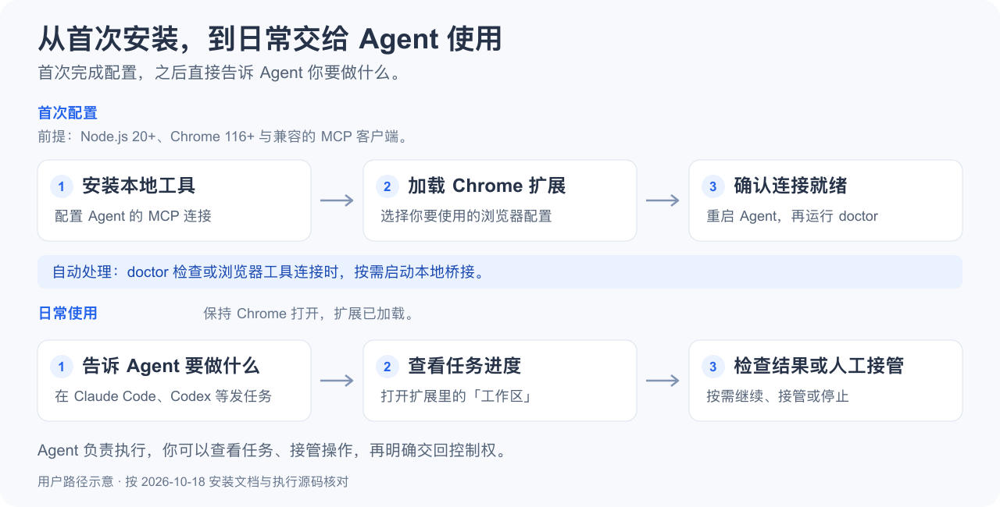
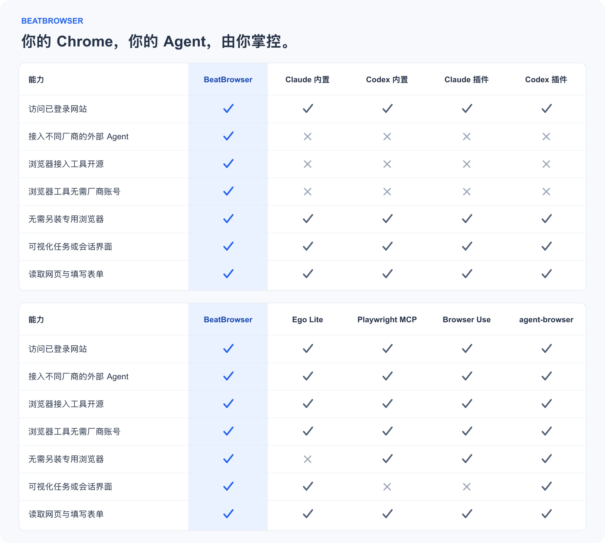
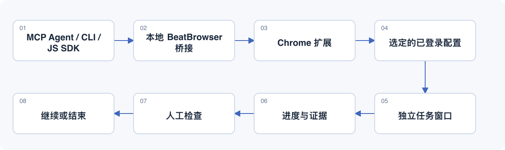

[](https://beatapi.io/browser)

# BeatBrowser

[English](README.md) · **[简体中文](README.zh-CN.md)**

**不用换浏览器，你的 Chrome 就是 Agent Browser。**

**无需专用浏览器 · 无需迁移登录态 · Agent 自由选择**

保留现有浏览器、登录态与使用习惯，让 Codex、Claude Code 等兼容 Agent 直接在 Chrome 里完成网页任务。任务使用独立后台窗口，你随时查看、暂停或接管。BeatBrowser 是免费、MIT 开源的 Chrome 扩展与本地桥接工具。

[快速开始](#快速开始) · [云端 Agent](#云端-agent你的-chrome) · [使用示例](#可以用来做什么) · [能力对比](#浏览器接入方式对比) · [JavaScript SDK](docs/JAVASCRIPT.md) · [项目官网](https://beatapi.io/browser)

普通本地浏览器工具**免费**，**不需要 BeatBrowser 账号或 API Key**；Agent 使用自己的模型服务。

## 为什么用 BeatBrowser

| 为什么选 BeatBrowser | 你能得到什么 |
| --- | --- |
| **保留现有 Chrome** | 使用原来的浏览器与配置。 |
| **保留现有登录态** | 无需导出 Cookie 或迁移浏览资料。 |
| **Agent 自由选择** | 接入 Codex、Claude Code、WorkBuddy 等。 |
| **工具链源码公开** | 扩展、桥接、MCP、CLI、SDK 均可检查和修改。 |
| **后台任务工作区** | 独立任务窗口，可暂停、继续或接管。 |
| **云端接入预览** | 自建认证入口，连接你本地的 Chrome。 |

扩展、桥接服务、MCP、CLI 和 Node SDK 源码按 [MIT](LICENSE) 公开。同一 Chrome 配置下的任务共享 Cookie 与存储。

## 选择使用模式

| 模式 | Agent 在哪里 | 需要配置什么 |
| --- | --- | --- |
| **本地 Agent** | 你的电脑 | 本地工具与 Chrome 扩展，无需域名或隧道。 |
| **云端 Agent** | 远程服务或电脑 | 本地工具、扩展、独立凭证，以及自己的隧道。 |

默认本地模式，安装不会开启远程访问。两种模式都使用你电脑上的 Chrome。
`1.4.1` 已包含可选的云端适配层，仍作为预览功能提供。[云端 Agent 配置教程](docs/REMOTE.zh-CN.md)

### 接入你常用的 Agent

| 模式 | Agent 示例 |
| --- | --- |
| 本地 | Codex、Claude Code、WorkBuddy、OpenCode、Kimi Code |
| 云端 | Muse、Grok Bot、OpenClaw、Hermes |

OpenClaw、Hermes 在此以云端部署举例；在你的电脑上运行时，也可以使用本地模式。
更多 Agent、具体配置与验证状态，见完整[Agent 接入目录](docs/AGENT_DIRECTORY.zh-CN.md)。

## 快速开始

**本地 Agent 模式**需要 **Node.js 20+**、**Chrome 116+** 和能够启动本地 stdio MCP 服务的客户端。安装分为两部分：本地工具与 Chrome 扩展。



### 1. 安装本地工具

```sh
npm install --global @beatapi/beat-browser@1.4.1
beat-browser install --dry-run
beat-browser install
beat-browser extension
```

`--dry-run` 预览已检测到的客户端配置改动；实际安装会备份被修改的配置。请保留安装目录，确保扩展路径稳定。

### 2. 加载 Chrome 扩展

1. 在你要使用的 Chrome 配置中打开 `chrome://extensions`，启用**开发者模式**。
2. 点击**加载已解压的扩展程序**，选择 `beat-browser extension` 输出的目录。每个配置只加载一份。
3. 重启 Agent 客户端，检查连接：

```sh
beat-browser doctor --json
```

就绪条件是 `ok: true` 和 `extensionOnline: true`。当前通过加载已解压扩展安装，尚未上架 Chrome 应用商店。

[配套下载与源码安装](docs/INSTALL.md) · [Agent 安装指南](AGENT_INSTALL.md) · [更新说明](docs/RELEASE_NOTES.md)

<details>
<summary>让 Agent 引导安装</summary>

把下面这段话发给你的 Agent：

```text
请从 https://github.com/BeatAPI/BeatBrowser 安装 BeatBrowser。
先阅读 AGENT_INSTALL.md，预览客户端配置改动，再引导我加载 Chrome 扩展。
最后检查 doctor，确认 ok 和 extensionOnline 均为 true。
```

提供某个客户端的配置适配器，不代表已对每个客户端完成端到端验收。使用 [BeatGEO](https://github.com/BeatAPI/BeatGEO) 时，按它内置的 BeatBrowser 安装流程操作，无需再装第二份。

</details>

### 试试第一个任务

```text
使用 BeatBrowser，列出已连接的 Chrome 配置；如果有多个，让我选择。
在 https://example.com 创建后台任务，读取标题，汇报结果，然后暂停等我检查。
```

点击扩展 → **工作区** 查看任务。Agent 负责推理，BeatBrowser 提供浏览器工具。

## 云端 Agent，你的 Chrome

**Agent 在云端，浏览器留在你的电脑。**

通过可选远程适配层与自己的 Cloudflare 隧道，让兼容的云端 Agent 操作已登录的 Chrome。
使用自己的域名，为每个 Agent 分配独立凭证，在扩展工作区查看和接管任务。
无需租用云浏览器或注册 BeatBrowser 账号；你的电脑仍需保持在线。

**可选预览**：`1.4.1` 的源码与 npm 包均包含远程命令，默认不开启远程访问。
参照[云端接入教程](docs/REMOTE.zh-CN.md)，配置 Muse、Grok Bot 或其他支持 Bearer 认证的
HTTP MCP、HTTP 调用或 WebSocket 的客户端。具体客户端设置与登录任务仍需端到端验收。

## 可以用来做什么

| 任务 | 提示词示例 |
| --- | --- |
| 整理已登录页面 | “从这些页面提取指定字段，整理成带来源链接的表格，不修改记录。” |
| 预填表单 | “按我提供的信息填写表单，检查内容，在最终提交之前暂停。” |
| 比较多个来源 | “用两个独立后台任务读取这两个网址，分别总结，等待我检查。” |

以上为示例提示词，目前暂无演示录屏。有些网站会在输入时自动保存，演练请使用专门的演示表单。[任务示例与操作步骤](docs/DEMO.md)

## 浏览器接入方式对比

比较浏览器接入方式与文档提供的模式，不比较模型能力或未经实测的性能。



<!-- comparison-tables:start -->
<details>
<summary>展开查看文字对比表</summary>

| 能力 | BeatBrowser | Claude 内置 | Codex 内置 | Claude 插件 | Codex 插件 |
| --- | :---: | :---: | :---: | :---: | :---: |
| 访问已登录网站 | ✅ | ✅ | ✅ | ✅ | ✅ |
| 接入不同厂商的外部 Agent | ✅ | ❎ | ❎ | ❎ | ❎ |
| 浏览器接入工具开源 | ✅ | ❎ | ❎ | ❎ | ❎ |
| 浏览器工具无需厂商账号 | ✅ | ❎ | ❎ | ❎ | ❎ |
| 无需另装专用浏览器 | ✅ | ✅ | ✅ | ✅ | ✅ |
| 可视化任务或会话界面 | ✅ | ✅ | ✅ | ✅ | ✅ |
| 读取网页与填写表单 | ✅ | ✅ | ✅ | ✅ | ✅ |

| 能力 | BeatBrowser | Ego Lite | Playwright MCP | Browser Use | agent-browser |
| --- | :---: | :---: | :---: | :---: | :---: |
| 访问已登录网站 | ✅ | ✅ | ✅ | ✅ | ✅ |
| 接入不同厂商的外部 Agent | ✅ | ✅ | ✅ | ✅ | ✅ |
| 浏览器接入工具开源 | ✅ | ✅ | ✅ | ✅ | ✅ |
| 浏览器工具无需厂商账号 | ✅ | ✅ | ✅ | ✅ | ✅ |
| 无需另装专用浏览器 | ✅ | ❎ | ✅ | ✅ | ✅ |
| 可视化任务或会话界面 | ✅ | ✅ | ❎ | ❎ | ✅ |
| 读取网页与填写表单 | ✅ | ✅ | ✅ | ✅ | ✅ |

</details>
<!-- comparison-tables:end -->

开源指接入工具，不代表宿主 App 或浏览器内核开源。Ego 可导入 Chrome 登录态；BeatBrowser 通过扩展与本地桥接使用现有 Chrome 配置。Playwright 包含插件模式，Browser Use 指本地库与 CLI，agent-browser 包含自带 Dashboard。核对日期为 2026-10-18。[维度定义与一手来源](docs/COMPARISON.md)。

**逐项对比：** [Ego Lite](docs/comparisons/ego-lite.md) · [Claude 内置](docs/comparisons/claude-built-in.md) · [Codex 内置](docs/comparisons/codex-built-in.md) · [Claude 插件](docs/comparisons/claude-extension.md) · [Codex 插件](docs/comparisons/codex-extension.md) · [Playwright MCP](docs/comparisons/playwright-mcp.md) · [Browser Use](docs/comparisons/browser-use.md) · [agent-browser](docs/comparisons/agent-browser.md)。

## 后台工作区



*此处为流程示意图。实际任务可在扩展 popup 或侧栏中查看。*

任务保留命名页面、进度和生命周期记录。你可以接管页面、明确交回控制权，或停止任务。结束后支持单个或批量清理，同时保护用户关联、已交给用户和移出任务窗口的页面。

<details>
<summary>恢复机制与当前限制</summary>

- 扩展重载后保留任务记录、页面名和进度；未完成任务以**暂停**状态恢复。浏览器完全重启后，通过**关联页面**确认缺失页面，再明确继续；不会仅凭相同网址接管页面。
- 每个 owner 最多 **4 个未结束任务**，每任务最多 **16 个页面**。任务窗口不等于独立 Cookie 容器。
- 聚焦任务窗口会暂停后续自动化，无法撤回已经发出的操作。网站弹窗或浏览器原生界面仍可能获得焦点。
- **有头最小化截图仍有已知限制。** 后台执行不等于绝对隐形，也不保证所有原生权限弹窗都能处理。
- 更新前先结束当前操作。保持 CLI 与扩展版本一致，重载扩展、重新连接 Agent；保留扩展存储才能保留任务记录。

[任务生命周期、恢复与验证](docs/TASKSPACES.md) · [工作区验收](docs/PREVIEW_TESTING.md)

</details>

## 工具

本地 Agent 模式提供 **24 个普通 MCP 工具**，其中 `spaces` 用于后台任务。
云端 Agent 模式提供 21 个，不含本地文件工具与保存的网站经验，详见[远程模式范围](docs/REMOTE.zh-CN.md#接口范围与验收边界)。

| 用途 | 工具 |
| --- | --- |
| 观察 | `snapshot`、`read_text`、`query`、`screenshot` |
| 导航 | `navigate`、`tabs` |
| 操作 | `act`、`click`、`type`、`fill`、`select`、`key`、`scroll`、`wait` |
| 数据传输 | `network`、`fetch`、`download`、`upload` |
| 人工与上下文 | `ask`、`status`、`learnings`、`spaces` |
| 高级操作 | `eval`、`reload` |

先观察页面，再操作，并明确传入 `tabId` / `spaceId`，最后核实结果。点击成功不等于业务操作成功。登录、验证码、OTP 和需要用户决定的步骤使用 `ask`。可以连接多个客户端，但普通模式下同时修改同一标签页并不隔离。

审核过的站点笔记与操作手册保存在 `~/.beat-browser/learnings/`，供不同 Agent 复用。这是共享上下文，不是自动训练模型。[JavaScript SDK](docs/JAVASCRIPT.md) · [任务示例与操作步骤](docs/DEMO.md) · [注明时间的集成对比](docs/COMPARISON.md)

## 隐私

普通模式使用监听 `127.0.0.1` 的本地桥接，Agent 连接需要本地令牌，不新增 BeatBrowser 云服务或遥测。工具结果仍会传给你选择的 Agent 与模型提供方；本地任务记录保留至清理。

扩展拥有较广的浏览器权限。请使用可信 Agent，并对有后果的操作保留明确授权；任务控制不构成全局授权机制。[完整隐私与权限说明](PRIVACY.md)

## 开发与参考

```sh
npm ci
npm test
npm run check:syntax
npm run check:security
npm run check:comparison
npm run check:package
```

[JavaScript SDK](docs/JAVASCRIPT.md) · [Agent 安装](AGENT_INSTALL.md) · [架构](media/architecture.svg) · [测试记录](TEST_RESULTS.md) · [发布流程](docs/RELEASING.md) · [反馈问题](https://github.com/BeatAPI/BeatBrowser/issues)

欢迎提交问题与 PR，请附上 CLI/扩展版本、复现步骤和脱敏输出，不要包含令牌、Cookie 或私有页面数据。单元测试和隔离 Chromium 检查不代表已验收每个 Agent 客户端或 macOS 原生焦点行为。

<details>
<summary>可选 BeatAPI 执行能力 — Fast JEV</summary>

Fast JEV 让 BeatAPI 模型从有限的浏览器动作中选择下一步，复用相同连接，**默认关闭**。真实调用需要 BeatAPI Key 和明确任务授权，普通浏览器工具不需要。

```sh
beat-browser run --dry-run \
  --url https://example.com \
  --goal 'Check that the Example Domain page is ready'
```

Dry-run 不调用模型、不连接浏览器。Fast JEV 面向顶层 light DOM，不支持 iframe 或 shadow DOM；遇到不确定状态会停止，不自动重发结果不明的提交。[配置与授权](docs/JEV_FAST_AGENT.md)

</details>

## 许可证

本项目采用 [MIT 许可证](LICENSE)。
