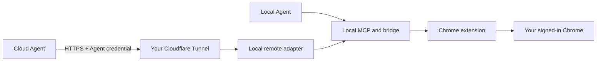

# Cloud agents, your signed-in Chrome

Run the agent in the cloud and keep the browser on your computer. Reuse your
website logins and inspect tasks in the Chrome extension Workspace. No cloud
browser rental or BeatBrowser-operated relay is required.

**Source preview:** remote commands are implemented in this checkout. The
published `1.3.2` npm package and release downloads do not include them yet.
Use the current repository source instead of installing the old npm package.

[Chinese guide](REMOTE.zh-CN.md) · [Local Agent setup](INSTALL.md) · [Privacy](../PRIVACY.md)

## Choose a mode

| Mode | Agent location | Connection | Required setup |
| --- | --- | --- | --- |
| Local Agent | Your computer | Local stdio MCP → local bridge → Chrome | Local tools and extension; no tunnel or domain |
| Cloud Agent | Remote service or computer | Authenticated tunnel → remote adapter → local MCP/bridge → Chrome | Local tools and extension, dedicated credential, your own tunnel |

Local Agent mode is the default. Installing local tools does not enable remote
access. Both modes use your computer's Chrome and can coexist; credentials are
not separate browser profiles or cookie containers.

- **Local Agent examples:** Codex, Claude Code, WorkBuddy, OpenCode.
- **Cloud Agent examples:** Muse, Grok Bot.

See the [Agent directory](AGENT_DIRECTORY.md) for local clients, cloud connector
candidates and deployment-specific configuration notes.



The cloud client must support Bearer-authenticated Streamable HTTP MCP, HTTP
calls or WebSocket. Muse and Grok Bot are integration examples; available tools
and configuration fields depend on the client version. Clients unable to call
an external endpoint need an additional client-side integration.

## 1. Prepare local tools and Chrome

Clone the current source into a permanent folder:

```sh
git clone https://github.com/BeatAPI/BeatBrowser.git
cd BeatBrowser
npm ci
node src/cli.js extension
```

If you already have this source checkout, use it rather than installing a second
copy. The released `v1.3.2` tag does not include the remote adapter.

Load the printed folder through Chrome's **Developer mode → Load unpacked**.
Keep the folder at a stable location. Then check:

```sh
node src/cli.js doctor --json
```

Require `ok: true` and `extensionOnline: true`. The bridge starts on demand.
You do not need to configure a local coding agent for Cloud Agent mode.

## 2. Create credentials and start remote access

```sh
node src/cli.js remote add grok
node src/cli.js remote add muse
node src/cli.js remote start
```

Names are examples; create only the clients you use. Each Agent gets an
independent credential, expiring after 90 days by default (`--days 1` to
`--days 365`). Tokens are saved privately, not printed. Records contain SHA-256
hashes; local token and connection files contain the credential itself.

`remote start` runs in the background on `127.0.0.1:18920`. It does not install
a login service; start it again after reboot. Use `remote serve` to run in a
terminal. Keep the source checkout in place.

## 3. Create your own Cloudflare Tunnel

Use your own Cloudflare account and domain. In **Networking → Tunnels**, create
a tunnel and install/run `cloudflared` on the computer running Chrome. Add a
published application route:

| Setting | Example |
| --- | --- |
| Hostname | `chrome.example.com` — replace with your own hostname |
| Service type | HTTP |
| Service URL | `127.0.0.1:18920` |

Use the actual port reported by `remote start`. **Do not forward the raw local
bridge on port `18899`.** The authenticated remote adapter is the tunnel target.

Tunnel is available on Cloudflare's free plan; domains and Agent/model services
can still cost money. See [Cloudflare setup](https://developers.cloudflare.com/tunnel/get-started/).
If Cloudflare Access is enabled, configure machine authentication your cloud
client can send in addition to BeatBrowser's Bearer header.

For a temporary test without an account or domain, install `cloudflared` and run:

```sh
cloudflared tunnel --url http://127.0.0.1:18920
```

Use its generated HTTPS hostname below. [Quick Tunnels](https://developers.cloudflare.com/tunnel/get-started/quick-tunnels/)
change hostname when recreated, have no uptime guarantee and do not support SSE.
This adapter uses JSON HTTP MCP responses, not SSE. Clients requiring long-lived
SSE are unsupported. Use a named tunnel for regular use.

## 4. Connect the cloud Agent

Replace the hostname with your own tunnel hostname:

```sh
node src/cli.js remote config --client grok --url https://chrome.example.com
```

Open the generated `~/.beat-browser/remote/grok.connection.json` locally. Copy
its URL and Authorization header into the cloud client's protected remote MCP
settings. Repeat with `--client muse` for Muse. This generic file is not a
claim that every client imports the same JSON format.

A public example uses a placeholder only:

```json
{
  "url": "https://chrome.example.com/mcp",
  "headers": { "Authorization": "Bearer <your dedicated Agent credential>" }
}
```

Do not put real credentials/config files in Git, screenshots or task prompts.
On POSIX, directories use `0700` and private files use `0600`; review OS access
controls on other platforms. No BeatBrowser hostname is needed.

## 5. Verify the route, then Chrome

```sh
node src/cli.js remote check --client grok --url https://chrome.example.com
node src/cli.js remote check --client grok --url https://chrome.example.com --browser
```

The first check verifies adapter identity and authentication through the public
route. `--browser` additionally lists connected profiles; at least one extension
must be online. It does not navigate or prove a website login remains valid.

Then ask the cloud Agent itself:

```text
Use BeatBrowser to list connected Chrome profiles. Ask me to choose if there
are several. Open a TaskSpace on https://example.com, read its title, report
and pause. Pass spaceId and tabId explicitly on later calls.
```

Inspect the task in the extension Workspace. Once that works, give the Agent a
specific task on the intended signed-in site. Connection access does not replace
authorization to send, publish, buy or delete. The computer must stay awake,
online and logged in, with Chrome and its extension connected.

## Manage access

```sh
node src/cli.js remote status
node src/cli.js remote clients
node src/cli.js remote rotate grok
node src/cli.js remote config --client grok --url https://chrome.example.com
node src/cli.js remote revoke muse
node src/cli.js remote stop
```

- `status` checks the adapter, not Chrome. Health and discovery do not start Chrome.
- Rotation invalidates the old token. Regenerate/replace the cloud connection
  configuration; the replacement gets a new local MCP session.
- Revocation rejects new requests immediately; WebSockets and local MCP
  connections are checked within five seconds. It cannot undo a site action
  already started. Inspect uncertain outcomes before issuing another action.
- Stop closes the adapter and its MCP subprocesses, leaving the local bridge
  running. Manage the separate tunnel with Cloudflare's tools.
- Remote audit records time, client, tool and status, not request bodies/tokens.
  It keeps one backup after about 1 MiB. Ordinary bridge and Agent logs have
  separate behavior; see [Privacy](../PRIVACY.md).

## Connection troubleshooting

| What you see | What to check |
| --- | --- |
| `remote` command not recognized | The published `1.3.2` package lacks this feature. Use the preview checkout and `node src/cli.js remote ...`. |
| Local adapter is not running | Run `remote start` from the same checkout and OS user. Check its printed log path if startup fails. |
| Tunnel cannot reach the local service | Run `remote status`; match the tunnel target to its port and keep `cloudflared` running on the Chrome computer. |
| HTTP 401 from the adapter | Check the dedicated Agent credential and its expiry/revocation. Regenerate client config after rotation. |
| HTTP 403 or an HTML login page | Check for an `Origin` header or a Cloudflare Access policy requiring a separate machine credential. |
| Adapter check passes but `--browser` fails | Run local `doctor --json`; open Chrome and reconnect the extension. |
| Local CLI check passes but the cloud Agent fails | Check that client's MCP URL, Bearer header and transport support. A local check does not validate its settings. |

Use only the root HTTPS hostname with `remote config --url` and `remote check --url`.
The generated MCP configuration adds `/mcp`; HTTP callers use `/call`. Copy the
generated values into the appropriate client fields, rather than adding the path twice.
When reporting an error, share sanitized status/error fields, never the token or
the private connection file. Do not retry an uncertain browser write just to test connectivity.

## HTTP and WebSocket APIs

HTTP requires `Authorization: Bearer <credential>`. URL query parameters and
requests with an `Origin` header are rejected. This is an Agent endpoint,
not an API for arbitrary browser pages. Use TLS across the public network.

| Route | Purpose |
| --- | --- |
| `GET /health` | Authenticated adapter liveness, not Chrome readiness |
| `GET /tools` | Available tool schemas |
| `POST /mcp` | Stateless Streamable HTTP MCP with JSON responses |
| `POST /call` | JSON `{"name":"spaces","arguments":{"action":"profiles"}}` |
| `WSS /bridge` | Agent WebSocket protocol |

For WebSocket, connect to `wss://chrome.example.com/bridge` and send:

```json
{"type":"hello","role":"agent","token":"<your dedicated Agent credential>","v":1}
```

After `welcome`, send commands with unique IDs:

```json
{"type":"cmd","id":"profiles-1","cmd":"spaces","params":{"action":"profiles"}}
```

Replies are `res` with the same ID, `ok`, and `data.content` (MCP content) or
an error. Include `tabId`/`spaceId` in `params` for task operations. Authenticate
within five seconds; a Bearer header can replace the hello's `token`.

## Scope and validation

Remote mode offers 21 normal browser tools. It excludes `upload`, `download`,
local saved `learnings`, `path`/`savePath` arguments, binary fetches and the
optional Fast JEV executor. Screenshots return MCP image content. Browser
operations themselves may still upload/download data or change a site; this is
not an OS sandbox or a per-Agent cookie container.

Limits: 1 MiB request/message bodies; 64 TCP connections; 120 requests per
minute per client; four browser calls in flight per client and sixteen total.
HTTP 429 or WebSocket `BUSY` rejects excess work. Never blindly replay a failed
write whose outcome is uncertain.

Automated checks cover HTTP MCP with the official client, HTTP calls, WebSocket,
credential expiry/rotation/revocation, private files, limits, background lifecycle
and the real stdio/bridge pipeline with a synthetic extension. They do not certify
Muse/Grok Bot UI versions, public tunnels, real signed-in websites, macOS focus
behavior or unattended uptime.

Chrome state stays on your computer. Requested page content/screenshots/results
cross your tunnel and reach your chosen Agent/model provider. This is not a
claim that all data stays on the computer.
